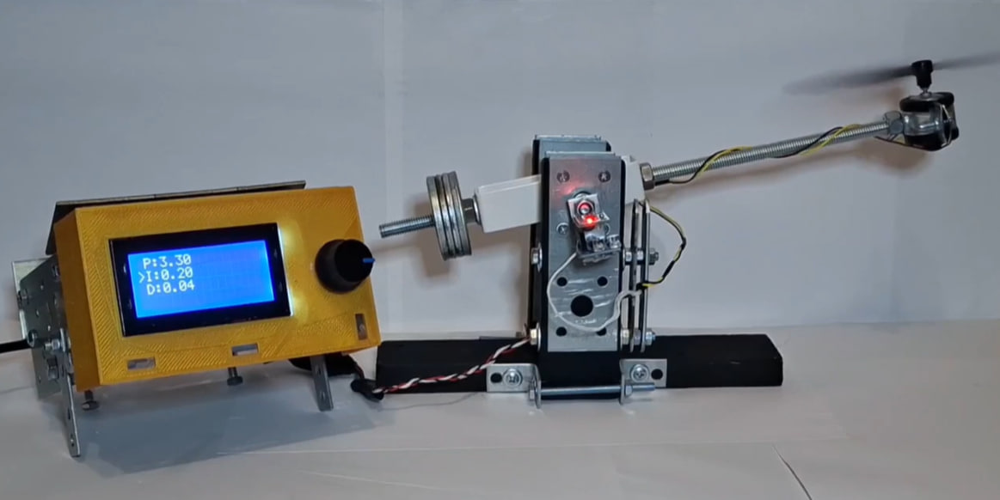
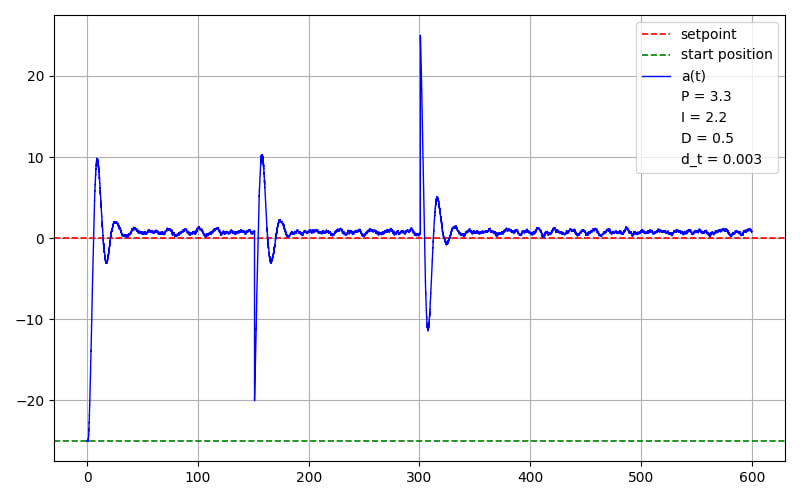

# Mechatronics Portfolio

I'm an Industrial Mechatronics student at TUKE. I build and test
electromechanical prototypes, with a focus on mechanical design
and embedded control.

## PID Angle Control of a Propeller-Driven Test Rig

An Arduino-based test rig for closed-loop angle control using an
MPU6050 sensor and a PID controller with anti-windup.

[View project documentation](<PID Angle Control of a Propeller-Driven Test Rig.pdf>)

